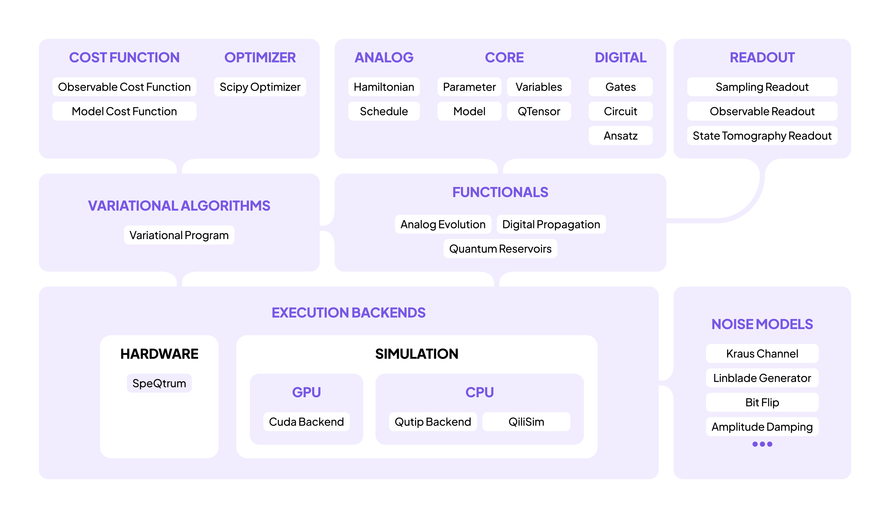
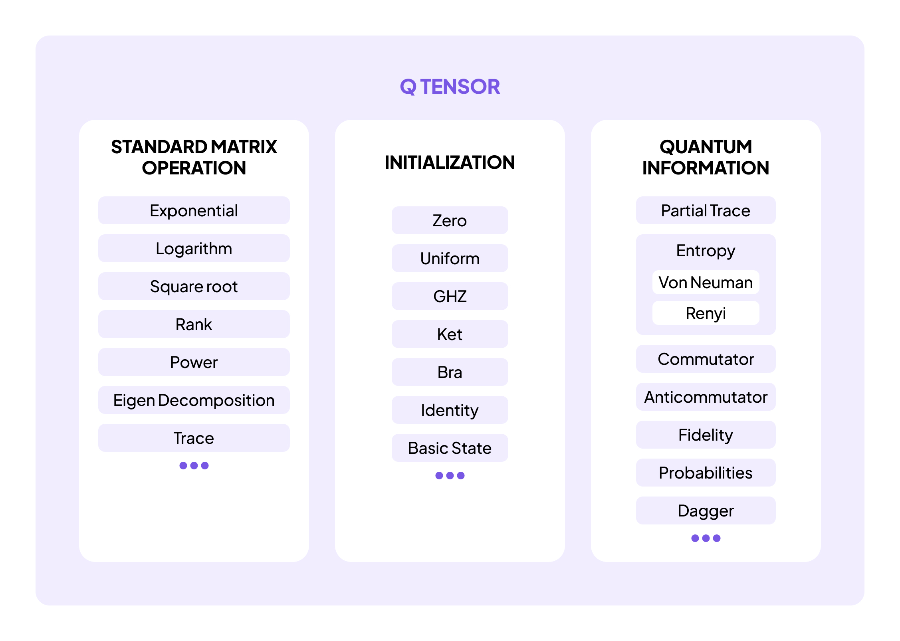

<!-- _class: lead -->
<!-- _paginate: false -->
<!-- _footer: '' -->

# Learn Quantum Computing with QiliSDK

PyCon Greece 2026

---

## Introduction

- **Vyron Vasileiadis**, Tech Lead at **Qilimanjaro Quantum Tech** · vyron@qilimanjaro.tech
- **Qilimanjaro** builds **analog quantum computers**, **multimodal data centers**, and the software to run them.
- **QiliSDK** is that software stack's open-source Python SDK: **digital** and **analog** quantum computing in one API, along with the C++ **QiliSim** simulator. It is the tool we will use today.

---

## Why quantum computing?

- **Simulating molecules and materials** is the most natural fit for a quantum computer, because describing $n$ interacting quantum particles classically needs $2^n$ numbers while a quantum computer holds that state directly.
- **Combinatorial optimization** problems such as scheduling, routing, and portfolio selection can be rewritten as finding the lowest point of an energy landscape, which is what a quantum annealer is built to seek.
- **Machine learning** can use a quantum system to transform input data or generate samples, because some quantum probability distributions are hard for a classical computer to reproduce.
- **True randomness** can come from quantum measurements, whose outcomes are fundamentally unpredictable rather than produced by a deterministic algorithm.

---

## Quantum computing in 2026

- **Today's quantum computers are not general-purpose accelerators**, so they will not speed up everyday software. Their advantages come from particular ways of solving particular problems.
- **The hardware today** is noisy, small, and expensive, but it is available for experiments and research.
- **A simulator on your laptop** is a practical way to learn: it runs the examples in this tutorial without access to a quantum computer.
- **The circuits you write are useful beyond the simulator.** They describe computations that can be compiled for compatible hardware; we will see how a chip's wiring affects that compilation.

---

<!-- Schedule slide, currently replaced by the Links & QR codes slide below. Uncomment to restore.
## Schedule

| Part | Topic | Time |
|---|---|---|
| - | Introduction and opening the first notebook | 10 min |
| 1 | Foundations: qubits, states, measurement, entanglement | 25 min |
| 2 | Circuits / Digital Quantum Computing, ending with the transpiler | 45 min |
| - | Wrap-up and questions | 10 min |

90 minutes in total. Adjust the timing to the group’s pace.
-->

## Links & QR codes

This tutorial

<a href="https://github.com/qilimanjaro-tech/pycon-greece-2026-qilisdk-tutorial">github.com/qilimanjaro-tech/ pycon-greece-2026-qilisdk-tutorial</a>

QiliSDK source

<a href="https://github.com/qilimanjaro-tech/qilisdk">github.com/qilimanjaro-tech/qilisdk</a>

Documentation

<a href="https://qilimanjaro-tech.github.io/qilisdk">qilimanjaro-tech.github.io/qilisdk</a>

---

## Follow along

Choose a notebook environment:

- **Local:** install `qilisdk==0.3.0` with pip using Python 3.11–3.14. Follow the main `README.md` for JupyterLab setup.
- **Google Colab:** use the notebook's installation cell. It installs `qilisdk==0.3.0` if QiliSDK is missing, and leaves an existing installation unchanged.

Open **`notebooks/01_foundations.ipynb`** and run its first two code cells. The first should print `QiliSDK 0.3.0`; both should finish without errors.

QiliSDK's prebuilt packages include **QiliSim**, so installing a compatible package requires no compilation.

---

## How we'll work

- Most of the session takes place in the notebooks. Each part starts with a short explanation, continues with code we write together, and ends with exercises.
- Use `notebooks/…` to follow along and complete the `# TODO` cells.
- Completed exercises and saved outputs are in `notebooks/solutions/…`.
- The examples were verified with **QiliSDK 0.3.0**. Use that version to match the API shown here.

---

## What you'll build

- A **loaded quantum coin** whose chance of landing on 1 is set to 75% (Part 1).
- A **quantum dice roller** with an equal chance of each of six faces (Part 2).
- A **shared random bit for three parties**, so all three receive the same result (Part 2).
- A circuit **compiled for a chip layout**, with the extra gates counted (Part 2).

These examples connect states, measurement, gates, and circuits. All execution in this session uses a simulator.

---

## QiliSDK's architecture

<!-- Read from primitives through functionals to execution backends. The notebook examples use Core, Digital, Readout, and QiliSim; the other branches support later topics. -->

---

## Bra-ket notation

Quantum papers use **bra-ket notation** to write the complex column and row vectors you know from NumPy:

- A **ket** $|\psi\rangle$ ("ket psi") is a column vector. The basis states $|0\rangle$ and $|1\rangle$ represent definite 0 and 1 outcomes; $|0\rangle$ is `np.array([[1], [0]])`.
- A **bra** $\langle\psi|$ is its conjugate transpose, `psi.conj().T`: transpose the vector and conjugate its complex entries.
- For two qubits, $|01\rangle$ means $|0\rangle \otimes |1\rangle$. The **tensor product** $\otimes$ forms a joint vector by multiplying entries from the two vectors in pairs: `np.kron(ket0, ket1)`.

---

<!-- _class: divider -->

Part 1 · notebooks/01_foundations.ipynb

# Foundations

### Qubits, superposition, and measurement probabilities

---

## Part 1: states and measurement

- A **qubit's state** is represented here by two complex numbers, its **amplitudes**: one weight for $|0\rangle$, one for $|1\rangle$. Think `np.array([a, b])` with unit length.
- Measuring in the $|0\rangle$ / $|1\rangle$ basis gives each outcome probability $|\text{amplitude}|^2$ (the **Born rule**) and leaves the qubit in that basis state.
- Two qubits have four amplitudes, for $|00\rangle$, $|01\rangle$, $|10\rangle$, and $|11\rangle$; $n$ qubits have $2^n$.
- Measurement returns one $n$-bit outcome. **Interference**, the addition and cancellation of amplitudes, changes which outcomes are likely.

---

## Part 1: superposition and entanglement

- **Superposition:** more than one basis state has a nonzero amplitude.
- **Relative phase:** the difference between the angles of complex amplitudes. It affects how amplitudes combine during interference.
- **Entanglement:** a joint state that cannot be described by assigning an independent state to each qubit. Our two-qubit example produces matching random bits when measured.
- **`QTensor`** represents both states and operators, the matrices that act on states.

---

## `QTensor`: states and operators

<!-- The notebook uses state constructors, matrix operations, and probabilities. Partial trace, entropy, and fidelity are tools for further study. -->
<!-- Artwork review: img/qtensor.jpg labels von Neumann entropy as "Von Neuman". Correct the spelling in the source artwork when available; this repository contains only the raster image. -->

---

<!-- _class: divider -->

Part 2 · notebooks/02_circuits.ipynb

# Circuits & Digital Quantum Computing

### Interference, a dice roller, and compiling for a chip layout

---

## Part 2: gates and circuits

- **Gates** are reversible matrix operations. Hadamard ($H$) creates superposition from $|0\rangle$; controlled-NOT (**CNOT**) can then entangle it with a second qubit.
- A **circuit** is an ordered sequence of operations on qubits. These examples start with every qubit in $|0\rangle$.
- **Measurement** returns classical bits at the end of these circuits.
- A **shot** represents one preparation and measurement. Sampling `nshots` times gives counts whose relative frequencies approach the ideal probabilities as the sample grows.

---

## Part 2: executing a circuit

- **Functional:** what to run. `DigitalPropagation(circuit)` wraps a circuit so a backend can execute it.
- **Backend:** where to run it. We use the `QiliSim` simulator.
- **Readout:** what to collect, such as samples or state information. Supported readouts depend on the backend.

$$\texttt{Backend.execute(functional, readout)} \rightarrow \texttt{Result}$$

This separates the circuit's description from its execution: you build the circuit, choose a compatible backend, and request the results you need.

---

## Part 2: from circuit to chip

- A chip's **native gate set** lists its available operations; its **coupling map** lists connected qubit pairs.
- The **transpiler** is a compiler: it translates your gates into the chip's instructions and maps your circuit's qubits onto physical qubits.
- **SABRE** is the routing heuristic used here. It inserts **SWAP** operations to exchange qubit states until the required pairs can interact.
- Every extra gate is another opportunity for an error. Comparing a line and a ring of four qubits shows how better connectivity can reduce the number of gates needed.

---

## What the examples connect

**Loaded coin** → **dice roller** → **shared random bit** → **compiled circuit**

`QTensor` describes states and operators. `Circuit` describes operations, and `DigitalPropagation` wraps a circuit for execution. `Readout` selects the results collected by a backend such as `QiliSim`.

Compiling the QFT, a **quantum Fourier transform** circuit, shows how the chip's wiring changes the gate count without changing the intended computation.

---

## Going further

The **3-hour EuroPython 2026 tutorial** continues with:

- **Analog computing:** describing a system's energy with a Hamiltonian, then using quantum annealing to schedule conference talks.
- **Variational algorithms:** finding a molecule's lowest-energy state with the variational quantum eigensolver (**VQE**) and solving optimization problems with the quantum approximate optimization algorithm (**QAOA**).
- **Noise:** how gate errors affect answers, and how much error a calculation can tolerate.
- **Execution:** swapping backends, exporting circuits, and building a forecaster that uses a quantum system to process a sequence of inputs.

[github.com/qilimanjaro-tech/europython2026-qilisdk-tutorial](https://github.com/qilimanjaro-tech/europython2026-qilisdk-tutorial)

---

<!-- _class: lead -->
<!-- _footer: '' -->

# Thank you! 🙏
