

<!-- _class: lead -->
<!-- _paginate: false -->
<!-- _footer: '' -->

# Learn Quantum Computing with QiliSDK

PyCon Greece 2026

---

## Links & QR codes

This tutorial

<a href="https://github.com/qilimanjaro-tech/pycon-greece-2026-qilisdk-tutorial">github.com/qilimanjaro-tech/ pycon-greece-2026-qilisdk-tutorial</a>

QiliSDK source

<a href="https://github.com/qilimanjaro-tech/qilisdk">github.com/qilimanjaro-tech/qilisdk</a>

Documentation

<a href="https://qilimanjaro-tech.github.io/qilisdk">qilimanjaro-tech.github.io/qilisdk</a>

---

## Introduction

- **Vyron Vasileiadis**, Tech Lead at **Qilimanjaro Quantum Tech** · vyron@qilimanjaro.tech
- **Qilimanjaro** builds **analog quantum computers**, **multimodal data centers**, and the software to run them.
- **QiliSDK** is that software stack's open-source Python SDK: **digital** and **analog** quantum computing in one API, along with the C++ **QiliSim** simulator. It is the tool we will use today.

---

## What is quantum computing?

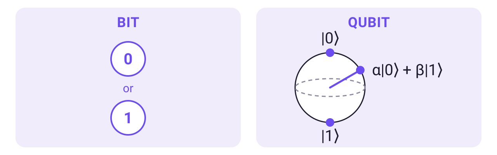

- Quantum computing uses quantum-mechanical effects to store and process information.
- Its unit is the **qubit**, which holds two **amplitudes**, α for 0 and β for 1. Measuring it gives a single bit, with probabilities set by the amplitudes.
- A qubit is any physical system with two states we can tell apart and control: two energy levels of a superconducting circuit cooled close to absolute zero, a trapped ion or atom, or a photon's polarization.

<!-- A qubit is any physical system with two states we can tell apart and control: two energy levels of a superconducting circuit cooled close to absolute zero (what Qilimanjaro builds), a trapped ion or atom, or a photon's polarization. Say it plainly: a qubit is not "0 and 1 at the same time"; it has an amplitude for each, and reading it gives one bit. -->

---

## Why quantum computing?

- **Simulating molecules and materials** is the most natural fit: the exact state of $n$ interacting two-state particles takes $2^n$ numbers to store classically, while $n$ qubits hold it physically.
- **Combinatorial optimization** problems such as scheduling and routing can be rewritten as finding the lowest point of an energy landscape, which a quantum annealer is built to seek.
- **Machine learning:** circuits with trainable parameters can serve as models, much like small neural networks, and a quantum system can process time series (reservoir computing).
- **Cryptography:** Shor's algorithm on a large error-corrected quantum computer would break RSA and elliptic-curve keys, so post-quantum standards are already being deployed.
- **True randomness** comes from quantum measurements, whose outcomes no algorithm can predict. Small quantum random number generators are already sold as products.

<!-- Simulation: classical approximations work well for many molecules; the hard cases are strongly correlated ones, such as some catalysts and magnetic materials. Machine learning: other directions are quantum kernels and generative models; the clearest proven gains are for data that is already quantum, from experiments or sensors, and whether quantum models beat classical ones on everyday data is still open. Cryptography: current estimates put RSA-2048 at under a million physical qubits (Gidney, 2025); the most accurate gate-based machines today have about 100-160. NIST published the first post-quantum standards in 2024, and OpenSSL 3.5 uses a hybrid ML-KEM key exchange by default when the server supports it. Grover's search gives only a square-root speedup, so larger symmetric keys stay safe. Randomness: in 2025 a 56-qubit quantum computer produced random bits that classical supercomputers then certified as freshly generated. -->

---

## Quantum computing in 2026

- **Today's quantum computers are not general-purpose accelerators**, so they will not speed up everyday software. They have beaten classical computers on purpose-built tasks; claims of an advantage on a practical problem are still disputed.
- **The hardware today** is small and noisy. Qubits are physical systems and they lose their state to their surroundings. Even good two-qubit gates fail about once in a few hundred to a few thousand operations.
- **A simulator on your laptop** runs this tutorial's examples: 16 GB of RAM holds the state of about 29 qubits, and each extra qubit doubles the memory needed.

<!-- Error correction spreads one reliable qubit over many physical ones. It works in experiments, but not yet at the scale that useful algorithms such as Shor's need. The most accurate gate-based machines have about 100-160 physical qubits; annealers have a few thousand. -->

---

## Digital and analog paradigm

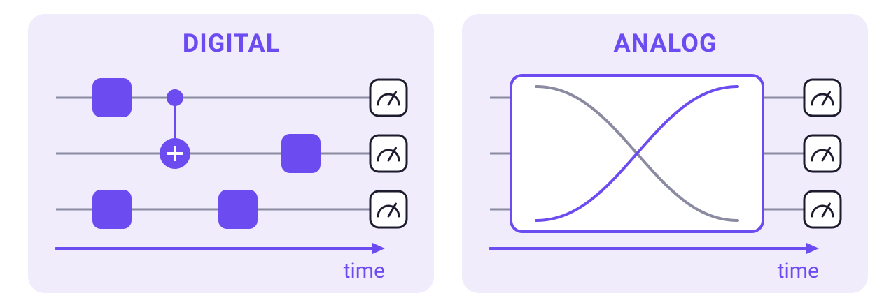

- **Digital:** a program is a sequence of gates on chosen qubits, like instructions on a CPU. Today's session is digital.
- **Analog:** the qubits' energy, described by a **Hamiltonian**, changes smoothly over time, and we measure where the system ends up.
- QiliSDK supports both.

---

<!-- Schedule slide, currently replaced by the Links & QR codes slide below. Uncomment to restore.
## Schedule

| Part | Topic | Time |
|---|---|---|
| - | Introduction and opening the first notebook | 10 min |
| 1 | Foundations: qubits, states, measurement, entanglement | 25 min |
| 2 | Circuits / Digital Quantum Computing, ending with the transpiler | 45 min |
| - | Wrap-up and questions | 10 min |

90 minutes in total. Adjust the timing to the group’s pace.
-->

## Follow along

Choose a notebook environment:

- **Local:** install `qilisdk==0.3.0` with pip using Python 3.11–3.14. Follow the main `README.md` for JupyterLab setup.
- **Google Colab:** use the notebook's installation cell. It installs `qilisdk==0.3.0` if QiliSDK is missing, and leaves an existing installation unchanged.

Open **`notebooks/01_foundations.ipynb`** and run its first two code cells. The first should print `QiliSDK 0.3.0`; both should finish without errors.

QiliSDK's prebuilt packages include **QiliSim**, so installing a compatible package requires no compilation.

Start now: the installation can run while we go through the next slides.

---

## How we'll work

- Most of the session takes place in the notebooks. Each part starts with a short explanation, continues with code we write together, and ends with exercises.
- Use `notebooks/…` to follow along and complete the exercise cells.
- Completed exercises and saved outputs are in `notebooks/solutions/…`.
- The examples were verified with **QiliSDK 0.3.0**. Use that version to match the API shown here.

---

## What you'll build

- A **loaded quantum coin** whose chance of landing on 1 is set to 75% (Part 1).
- A **shared random bit for three parties**, so all three receive the same result (Part 2).
- A circuit **compiled for a chip layout**, with the extra gates counted (Part 2).

These examples connect states, measurement, gates, and circuits. All execution in this session uses a simulator.

---

## QiliSDK's architecture

<!-- Read from primitives through functionals to execution backends. The notebook examples use Core, Digital, Functionals, Readout, and QiliSim; the other branches support later topics. -->
<!-- Artwork review: img/overall.jpg reads "Linblade Generator" (Lindblad), "Cuda Backend" (the class is CudaqBackend) and "Observable Readout" (ExpectationReadout), and draws SpeQtrum as a backend although in code it is a separate cloud client. Correct these in the source artwork when available. -->

Today's path: `Circuit` → `DigitalPropagation` → `QiliSim`, with a `Readout` for samples or exact probabilities.

---

<!-- _class: divider -->

Part 1 · notebooks/01_foundations.ipynb

# Foundations

### Qubits, superposition, and measurement probabilities

---

## Bra-ket notation

Quantum papers use **bra-ket notation** to write the complex column and row vectors you know from NumPy:

- A qubit's state is two complex **amplitudes**, $|\psi\rangle = \alpha|0\rangle + \beta|1\rangle$ with $|\alpha|^2 + |\beta|^2 = 1$. Think `np.array([alpha, beta])` with unit length.
- A **ket** $|\psi\rangle$ ("ket psi") is a column vector. The basis states $|0\rangle$ and $|1\rangle$ represent definite 0 and 1 outcomes; $|0\rangle$ is `np.array([[1], [0]])`.
- A **bra** $\langle\psi|$ is its conjugate transpose, `psi.conj().T`: transpose the vector and conjugate its complex entries.
- In Python, an amplitude such as `z = 0.6 + 0.8j` has a magnitude, `abs(z)`, and an angle, `cmath.phase(z)`. That angle is its **phase**.

---

## Part 1: Superposition and the Bloch sphere

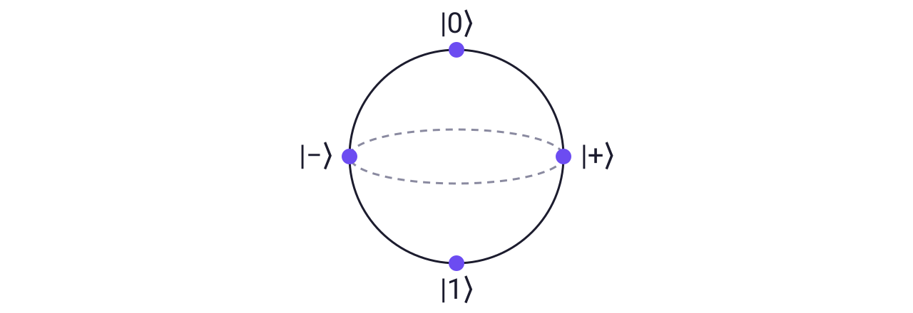

- **Superposition:** more than one basis state has a nonzero amplitude in the measured basis.
- On the **Bloch sphere**, a qubit's state is a point, and gates rotate the sphere.
- $|\pm\rangle = (|0\rangle \pm |1\rangle)/\sqrt2$ both measure 50/50. The sign is a **relative phase**, which decides how amplitudes combine when they interfere.

---

## Part 1: From amplitudes to counts

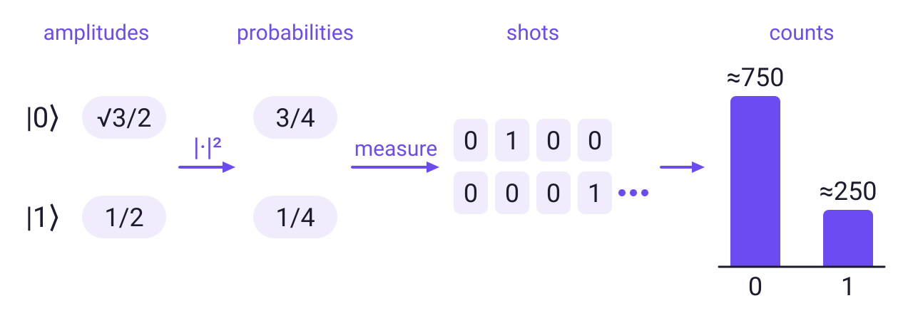

- **Born rule:** an outcome's probability is its amplitude's squared magnitude. Measuring returns one bit and **collapses** the qubit to that outcome.
- One preparation and measurement is a **shot**. Over many shots, the relative frequencies approach the probabilities.

---

## Part 1: Many qubits

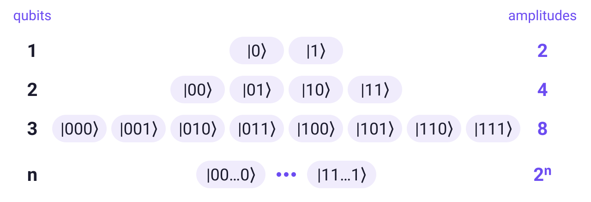

- The **tensor product** $\otimes$ combines qubits: every entry of one vector times every entry of the other, `np.kron(a, b)`. In QiliSDK's bitstrings, the first character is qubit 0.
- Each added qubit doubles the number of amplitudes: the state of 50 qubits takes about 18 PB to store. Measuring them still returns only 50 bits.

---

## Part 1: Entanglement

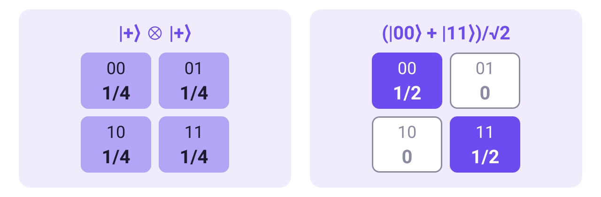

- **Entanglement:** a joint state that cannot be split into one state per qubit. Two separate $|+\rangle$ qubits (left) give all four outcomes; a Bell pair (right) gives only matching bits.
- A coin flipped once and copied to both sides also matches. The Bell pair keeps matching when both qubits are measured in the $|+\rangle$/$|-\rangle$ basis; the copies do not.
- It does not send messages: each side alone sees a fair coin, and the agreement shows only when the results are compared.

---

## `QTensor`: States and operators

Today we use `ket`, `bra`, `ghz`, `tensor_prod`, `@`, `.probabilities()`, and `.sample()`; the other tools are for further study.

<!-- The notebook uses state constructors, matrix operations, probabilities, and sampling. Partial trace, entropy, and fidelity are tools for further study. -->
<!-- Artwork review: img/qtensor.jpg reads "Von Neuman" (von Neumann) and "Basic State" (Basis State; the API is basis_state). Correct both in the source artwork when available; this repository contains only the raster image. -->

---

<!-- _class: divider -->

Part 2 · notebooks/02_circuits.ipynb

# Circuits & Digital Quantum Computing

### Interference, a shared random bit, and compiling for a chip layout

---

## Part 2: Gates

- A **gate** is a unitary matrix applied to the state: `state = U @ state`. Unitary gates are reversible, unlike AND or OR, and keep the probabilities summing to 1.
- Hadamard ($H$) turns $|0\rangle$ into the equal superposition $|+\rangle$. Controlled-NOT (**CNOT**) flips its target qubit when its control qubit is 1, and can entangle the two.
- **Measurement** is not a gate in this sense: it returns classical bits and cannot be undone.
- Rotation angles are keyword-only: `RX(0, theta=np.pi / 2)` rotates qubit 0. Passing the angle positionally raises a `TypeError`.

---

## Part 2: Reading a circuit

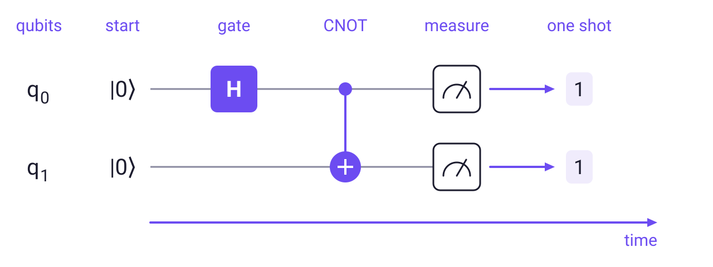

- Each wire is a qubit that starts in $|0\rangle$, with qubit 0 on top. Time runs left to right. The CNOT's dot marks its control and ⊕ its target. This is the Bell circuit you will run.
- Applying $A$ and then $B$ computes $B\,A\,|\psi\rangle$: the drawing reads left to right, the matrix product right to left.

---

## Part 2: Interference

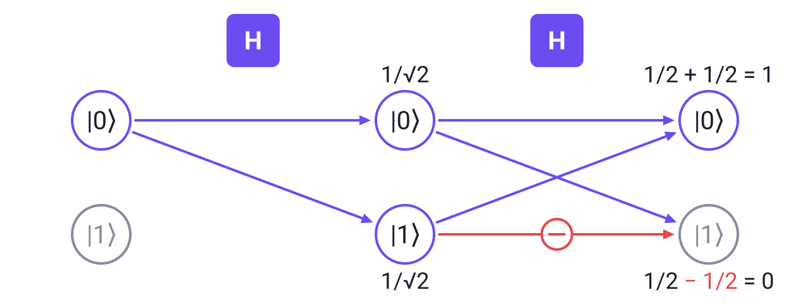

- Each arrow multiplies the amplitude by $1/\sqrt2$, the red one by $-1/\sqrt2$, and amplitudes arriving at the same state add. $H$ then $H$ returns $|0\rangle$ every time, while a classical coin randomized twice stays 50/50.
- Measuring between the two gates destroys the effect. Algorithms arrange cancellations like this so that wrong answers become unlikely.

---

## Part 2: Running a circuit

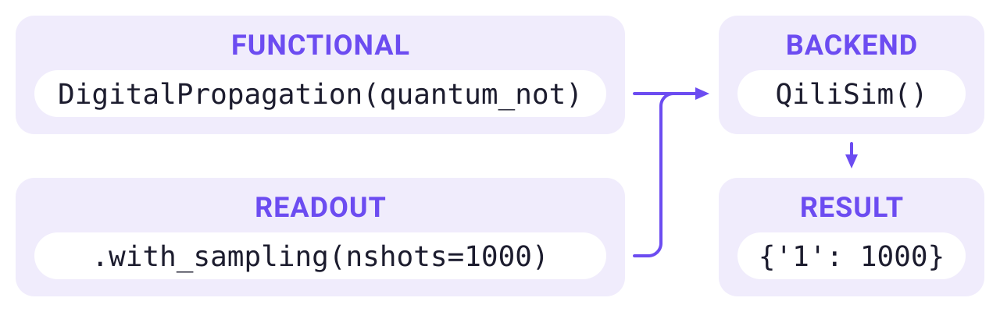

- **Functional:** what to run. **Backend:** where to run it. **Readout:** what to collect. Build the circuit once, then choose the backend and readout.
- Sampling runs the circuit `nshots` times, and the counts vary between runs (**shot noise**). A simulator can also return the exact probabilities; a quantum processor (QPU) only gives samples.

<!-- QiliSim is a classical program, so its samples are pseudorandom. Real QPUs are reached through the SpeQtrum cloud client, which has its own submit/wait calls. -->

---

## Part 2: From circuit to chip

- A chip's **native gate set** lists the operations it runs directly. Here that is the general single-qubit gate `U3` and the two-qubit `CZ`. Its **coupling map** lists which qubit pairs are linked.
- The **transpiler** is a compiler: it translates your gates into the chip's instructions and maps your circuit's qubits onto physical qubits.
- Qubits lose their state over time (**decoherence**) and every gate can fail, so every extra gate costs accuracy.

---

## Part 2: Routing with SWAP

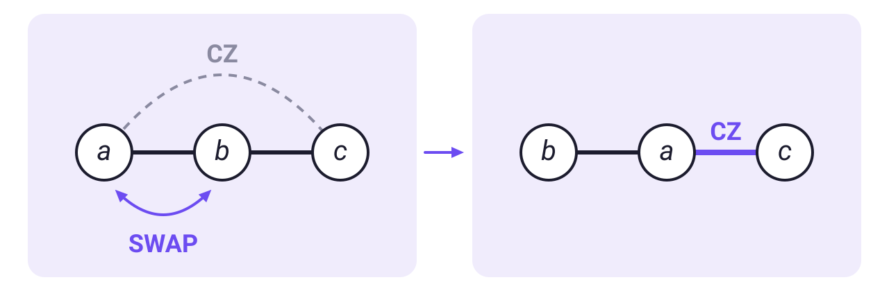

- When two states that must interact sit on unlinked qubits, the router (**SABRE** here) inserts **SWAP**s to bring them next to each other.
- Each SWAP costs three two-qubit gates. SABRE makes random choices, so the count can change between runs.

---

## Part 2: Line or ring

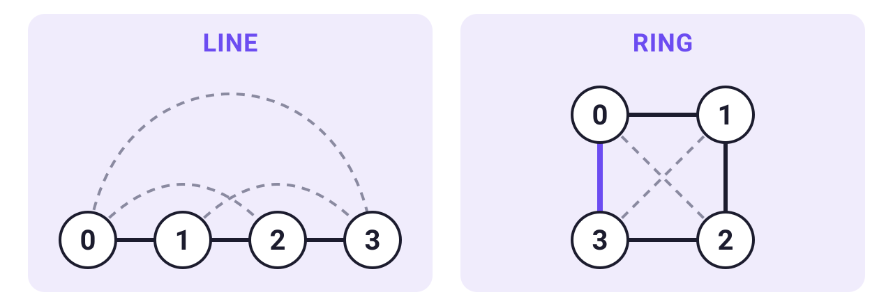

- Solid lines are couplers on the chip; dashed lines are pairs the QFT (quantum Fourier transform) circuit needs but the chip lacks.
- In Exercise 2.2 you add the coupler 3–0 to turn the line into a ring, then count the two-qubit gates it saves.

---

## What the examples connect

**Loaded coin** → **shared random bit** → **compiled circuit**

`QTensor` describes states and operators. `Circuit` describes operations, and `DigitalPropagation` wraps a circuit for execution. `Readout` selects the results collected by a backend such as `QiliSim`.

Compiling the QFT, a **quantum Fourier transform** circuit, shows how the chip's wiring changes the gate count. The compiled circuit computes the same thing, with its qubits relabeled, but a sparser chip needs more gates.

---

## Going further

The **3-hour EuroPython 2026 tutorial** continues with:

- **Analog computing:** describing a system's energy with a Hamiltonian, then using quantum annealing to schedule conference talks.
- **Variational algorithms:** finding a molecule's lowest-energy state with the variational quantum eigensolver (**VQE**) and finding approximate solutions to optimization problems with the quantum approximate optimization algorithm (**QAOA**).
- **Noise:** how gate errors affect answers, and how much error a calculation can tolerate.
- **Execution:** swapping backends, exporting circuits, and building a forecaster with **quantum reservoir computing**, where a quantum system processes a sequence of inputs.

[github.com/qilimanjaro-tech/europython2026-qilisdk-tutorial](https://github.com/qilimanjaro-tech/europython2026-qilisdk-tutorial)

---

<!-- _class: lead -->
<!-- _footer: '' -->

# Thank you! 🙏
